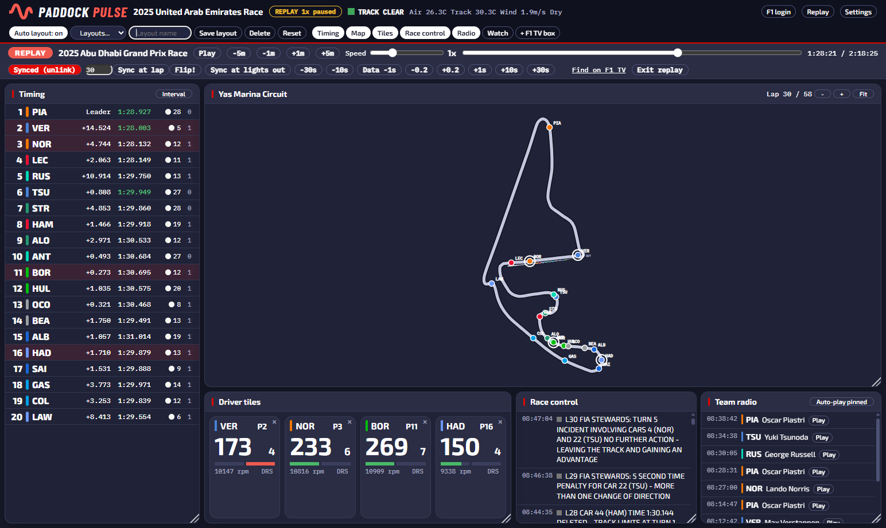

# Paddock Pulse

A live F1 dashboard and session replayer for the desktop. Timing tower, a live track map with the real circuit, pit lane and
team pit boxes, driver telemetry tiles, race control, team radio, weather, and F1 TV video boxes in the same window. Any past
session since 2018 can be replayed, with the F1 TV video and the data kept in sync.



> **Unofficial.** Paddock Pulse is an independent hobby project. It is not affiliated with, endorsed by or connected to
> Formula 1, the FIA, Formula One Management, Liberty Media or F1 TV. F1, FORMULA 1 and related marks belong to their owners.
> It reads F1's unofficial, undocumented live-timing and archive feeds with **your own** F1 TV login. F1 can change or block
> those at any time. It does not download, record or re-stream video, and it does not get around F1 TV's protection: video
> plays only inside the official F1 TV player, signed in with your own subscription. For personal use; please respect F1 TV's
> terms.

## What you need
- **Windows 10/11** (the desktop app and installer are Windows only; the browser version runs anywhere Node.js 18+ does).
- **An F1 TV subscription** for car positions, telemetry, replays and video. Without a login you still get timing, gaps,
  tyres, race control, radio and weather.

## Install
Download the installer (`Paddock-Pulse-Setup-x.y.z.exe`) from the [latest release](https://github.com/sorenthill2-glitch/Paddock-Pulse/releases/latest) and run it. Windows may warn about an unknown publisher
because the installer is not code-signed. The first time it opens, sign in to F1 TV inside the F1 TV box: the app picks the
login up by itself (details below).

## Run from source
```
npm install        # downloads the castLabs Electron fork: it includes Widevine, which F1 TV video needs
npm start          # desktop app
node server.js     # browser version at http://localhost:8080 (no F1 TV boxes)
```
Building the installer (`Build installer.bat`) needs a free castLabs EVS account so the build can be signed for Widevine; see
[CONTRIBUTING.md](CONTRIBUTING.md).

## Your F1 login
In the desktop app, the first time you open it (and whenever your login expires) an F1 TV box opens on F1's own sign-in page: sign in there. The app reads the `login-session` cookie from that box and uses it
(and picks up the new one whenever F1 refreshes it). You can also click **F1 login** and paste it, put it in `f1-token.txt`, or run
`F1_TOKEN=... node server.js`. To find it by hand: sign in at f1tv.formula1.com, open the developer tools, then Application,
Cookies, `login-session`. It expires now and then; the app tells you and opens the login window.

The login is stored as plain text in your user data folder (`%APPDATA%\paddock-pulse\f1-token.txt`), is only sent to F1's
servers, and is never shown to the page or logged. Never paste it anywhere public. See [SECURITY.md](SECURITY.md).

## Using it
**Header.** F1 login, Replay, Settings, then the layout controls and a button per panel (Timing, Map, Tiles, Race control,
Radio, Watch, + F1 TV box).

**Timing tower.** Drivers in race order with interval or gap to the leader (button in the panel header), last lap, tyre and tyre
age, and pit stops. Click a driver to pin a telemetry tile (up to 8). Retired drivers are greyed; a purple lap is the fastest of
the session.

**Driver tiles.** Live speed, gear, RPM, DRS and throttle/brake, with more detail (tyre, stops, best and last laps, ahead and
behind, speed graphs) as the tile gets bigger. Tiles are ranked by race position.

**Map.** The real circuit, pit lane and each team's box, traced from F1's recordings of the same circuit and season (cached
in `data/`; delete a file to rebuild it). Mouse wheel zooms, drag pans, click a car to follow it (speed, gear, RPM, throttle,
brake), double-click or **Fit** resets, Esc stops following.

**Race control and team radio.** Messages with flag colours; the track-status badge follows the latest one. **Play** on a
radio message plays the recording; **Auto-play pinned** plays new messages from pinned drivers.

**F1 TV boxes** (desktop only; up to 4). The normal F1 TV site, signed in as you. Buttons: Home, Back, Reload, Whole picture
(show the full frame with black bars instead of cropping), Video check (is Widevine available), Mute, Close. In a replay every
box, including ones you add later, opens the matching video; extra boxes start muted so they do not echo. Boxes can show
onboard cameras (they share the main broadcast's timeline).

**Layouts.** Panels arrange themselves when you turn them on or off (**Auto layout**). Drag a title bar to move, the bottom-right
corner to resize (neighbours give up or take the space; F1 TV boxes stay 16:9, hold Shift to resize freely). **Save layout**
keeps your own arrangement, **Delete** removes it, **Reset** goes back to auto.

**Settings.** Interface size (Auto fits the window; useful with Windows display scaling, for example a 2560×1440 screen at
225% is only about 1140×640 px to the app, where about 75% fits much more), colour theme (Dark, Light, System), compact header
(moves the layout buttons into the settings window), which F1 TV box the replay follows, and muting extra boxes.

## Replay
**Replay** in the header: pick a year, a track and a session (2018 on, except 2022, which F1 does not publish; a recording
appears some hours after a session ends). The server downloads F1's own recording (about 25 MB for a race) and plays it like a
live session. Recordings more than 3 days old are kept compressed in your data folder (up to 1 GB, oldest removed first), so opening the same session again takes a couple of seconds. The bar has play/pause, -5m/-1m/+1m/+5m, a speed slider (0.25x to 32x) and a position slider. In the desktop app
the first F1 TV box is sent through F1 TV's Archive (year, race weekend, session) to the matching video.

### Keeping video and data in sync
F1 TV's player does not expose the video's original clock, so the two are linked by an offset:
- **Starting point.** For 2024-and-later races the video is started at a typical lights-out position (~506 s into the video) or at the
  offset from your own earlier sync of that year and session type. It was within ~25 s on 9 of 11 races checked and minutes
  off on 2 (a delayed or wet start, a long pre-race show), so **check the broadcast lap counter against the Lap number above
  the map** and correct it if they differ. Older years have no typical value.
- **Sync at lap.** Type the lap the broadcast shows and press it: the data and the video both go to the start of that lap. If the
  app's current sync is wrong about the lap, it re-syncs to what the video shows instead.
- **Flip!** The exact calibration: press it the instant the broadcast lap counter flips to the lap in the box.
- **Sync at lights out** (put the video on the start; for practice and qualifying) and **Sync video** (line them up anywhere).
- **Data -30s … +30s** nudge the data against the video. The sync is remembered per session and the offset per year.
- Once linked, play, pause, skipping and speed on either side move both. The player's seek bar lands up to ~15 s from the
  target, so after a skip the data follows to where the video landed. Above 2x only play/pause follow (the video cannot play
  faster).

Details and measurements are in [docs/SYNC.md](docs/SYNC.md).

## Network and privacy
The app contacts `livetiming.formula1.com` (live feed and archive), `f1tv.formula1.com` (video, inside the F1 TV boxes), and
OpenF1 only if you configure it. Fonts are bundled. No analytics or telemetry. The local server listens on `127.0.0.1` only.
Optional environment variables: `F1_TOKEN`, `PORT`, `OPENF1_USER` / `OPENF1_PASS` (a paid OpenF1 login as an alternative live
source).

## Tests
```
npm test                       # layout (all 319 panel combinations at 5 window sizes), F1 TV matcher, feed parser: no login needed
node test-server.js            # needs your login: server abuse, replays from 2018-2025, control abuse, memory
node test-circuits.js 2025     # needs your login: traces every circuit of a season and sanity-checks it
npx electron test-login.js     # automatic login pickup from the F1 TV box
```

## Project layout
| File | What it is |
|---|---|
| `index.html` | the whole interface (HTML, CSS, JS) |
| `layout.js` | the auto-layout engine |
| `main.js`, `preload.js`, `f1login.js` | Electron shell, window, login pickup |
| `server.js` | local server: serves the page, proxies the data, controls replays |
| `f1feed.js`, `feedcore.js`, `stamp.js` | the live feed, message processing, recording clock parser |
| `replay.js`, `pitlane.js` | recorded sessions; circuit, pit lane and pit box tracing |
| `assets/` | logo and icon (see `assets/LOGO.md`), bundled fonts |
| `legacy/` | the first replay-only prototype, kept for reference |

## Known limits
- Windows only for the desktop app. Not code-signed.
- Depends on F1's unofficial feeds and on how F1 TV's player and pages are built; either can change without notice.
- Video/data sync is measured on a sample of races, not every session. Qualifying, practice and sprints have no lap counter to
  sync on. See [docs/SYNC.md](docs/SYNC.md).
- A few recordings are incomplete on F1's side (for example no car positions for the 2018 Bahrain GP).

## Licence
MIT, see [LICENSE](LICENSE). The logo files in `assets/` are used as supplied; the F1 name and marks are not covered by this licence.

## Credits
Fonts: Exo 2, IBM Plex Mono and Barlow Condensed, each under the SIL Open Font License (see `assets/fonts/`). Electron by castLabs
(Widevine build). The logo files in `assets/` are used as supplied.
